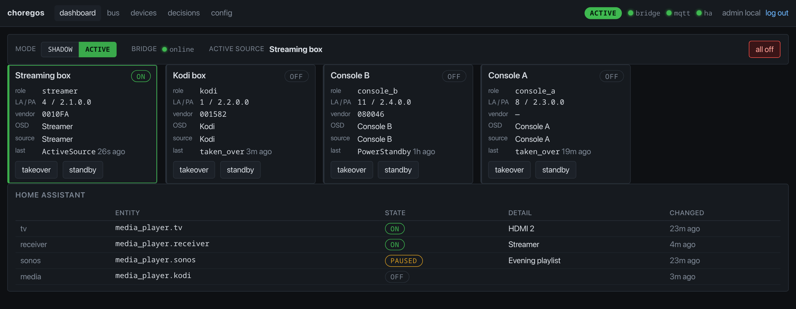
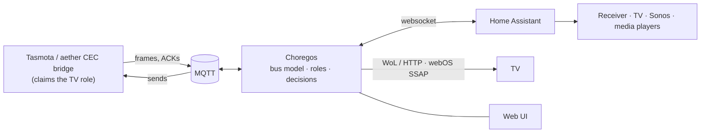
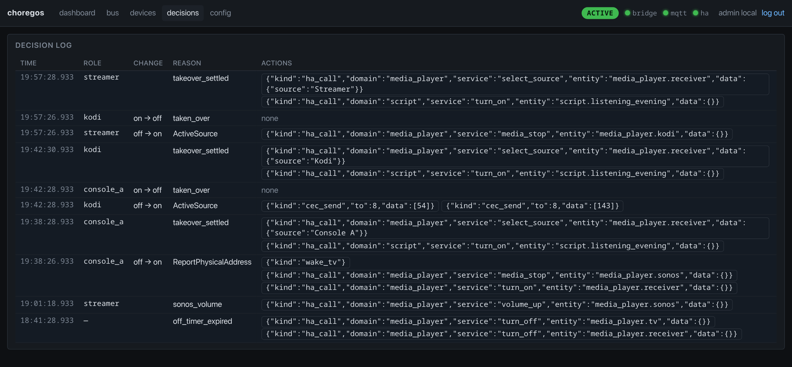

# Choregos

**A home-theater conductor.** Choregos listens to the HDMI-CEC bus through a
Tasmota or native aether CEC bridge and keeps the room in step: wake the TV and receiver when a
source wakes, pick the right input, put displaced sources to sleep, shut the
room down when the last one goes quiet. Use each source's own remote; Choregos
handles the rest.

[](https://github.com/yasen-pavlov/choregos/actions/workflows/ci.yml)
[](https://github.com/yasen-pavlov/choregos/releases)
[](https://sonarcloud.io/summary/new_code?id=yasen-pavlov_choregos)
[](https://sonarcloud.io/summary/new_code?id=yasen-pavlov_choregos)
[](LICENSE)



## Why

CEC alone almost works: devices announce themselves, the receiver follows the
active source, standby propagates. In a real room it falls apart at the edges.
A console that leaves the bus when it sleeps, a streamer that ignores Standby
while playing, a receiver that needs a nudge to switch inputs, a Sonos that
should follow the volume keys. Choregos owns those edges with an explicit,
testable model instead of a pile of automations.

## What it does

- **Learns the bus.** Devices are identified by OSD name, vendor ID and/or
  physical address, never by logical address alone, so sources that re-register
  on a different address are still recognised. Learned identities survive
  restarts and are re-verified on the bus before they are trusted.
- **Sequences the room.** A source waking triggers TV wake (Wake-on-LAN or
  HTTP), receiver power and input, a time-of-day Home Assistant preset, and a
  takeover of whatever was playing before. When the last source goes off, a
  cancellable delay powers down the TV and receiver.
- **Handles the awkward devices.** Presence polling for sources that vanish in
  standby; `Play: Still` before Standby for sources that ignore Standby while
  playing; verified standby with bounded retries; identity conflicts inhibit
  power actions rather than guess.
- **Forwards volume.** Remote volume keys reach Sonos while it is playing.
- **Integrates with Home Assistant.** MQTT discovery publishes per-role power
  sensors, active source, conflicts, bridge availability, a mode select and an
  all-off button; receiver, Sonos and media players use HA's integrations.
  TV power-off can use native webOS SSAP to avoid HA reconnect delays after wake.
- **Shows its work.** A web UI with dashboard, live bus stream, devices,
  decision log, config editor and manual actions, behind OIDC or a break-glass
  login.
- **Shadow mode.** Run the complete engine without touching anything and read
  what it *would* have done before switching it on.

## How it works



Every received frame updates a bus model and resolves configured roles. The
engine is a pure state machine: no network I/O, no clock reads. Injected time
drives startup warming, takeover settling, identification retries and
presence/off timers, which makes every behaviour replayable from a capture and
testable without hardware. MQTT, the HA websocket and TV power are thin adapters
that execute the engine's actions.

[DESIGN.md](DESIGN.md) is the behavioural contract; [docs/decisions.md](docs/decisions.md)
records the implementation choices made along the way.

## Requirements

- A CEC bridge wired to a spare HDMI input, claiming the TV logical address:
  either the native aether ESP32 firmware (aether MQTT protocol v1; separate
  project, not yet published), or Tasmota with HDMI-CEC support. Stock Tasmota works;
  the [patched firmware](https://github.com/yasen-pavlov/Tasmota/tree/ht/cec-v16)
  additionally reports target ACK/NACK. Native aether also distinguishes
  arbitration loss, line errors and busy outcomes from target absence.
- An MQTT broker the bridge publishes to.
- Home Assistant with `media_player` entities for the receiver and TV, plus a
  long-lived access token. Sonos is optional; a source needs an entity only if
  it is stopped through HA (`ha_media_stop`).
- Optional: an OIDC provider for the web UI.

## Quick start

Images are published to `ghcr.io/yasen-pavlov/choregos` for amd64 and arm64 on
every `v*` tag; `:edge` follows `main`. Pin a release tag for production.

```sh
mkdir -p config
cp choregos.example.toml config/choregos.toml
# Edit config/choregos.toml, then export the secrets listed below.
# The container runs as uid 65532 and needs to write config saves and state.
sudo chown -R 65532:65532 config
docker run --rm --name choregos -p 8095:8095 \
  --cap-drop ALL --security-opt no-new-privileges --read-only \
  -v "$PWD/config:/config" \
  -e CHOREGOS_MQTT_PASSWORD -e CHOREGOS_HA_TOKEN \
  -e CHOREGOS_SESSION_SECRET -e CHOREGOS_OIDC_CLIENT_SECRET \
  -e CHOREGOS_LOCAL_PASSWORD \
  ghcr.io/yasen-pavlov/choregos:latest
```

Mount the **directory**, not the single file: saves replace the file by atomic
rename, which does not update a single-file bind mount. A compose equivalent is in
[`deploy/docker-compose.yml`](deploy/docker-compose.yml). The static musl image
has no shell; its health check runs `choregos healthz --url http://127.0.0.1:8095/healthz`,
and `/healthz` is unauthenticated and reports MQTT/HA connections, bridge
availability and mode. The check only verifies that the web process answers;
a healthy process is never restarted because an external system is offline.
Put the UI behind HTTPS.

Wake-on-LAN from a bridge network works when `tv.wake.broadcast` is a directed
broadcast (e.g. `192.168.1.255`) that your router forwards to the TV's network.
Otherwise use `network_mode: host`, or the `http` wake variant with a LAN wake
service.

Native webOS off uses only TLS (`wss`, port 3001 by default) and an existing
pairing key from `tv.off.key_env`; it does not initiate pairing. LG's self-signed
certificate is accepted only for this connection, so use a trusted LAN.
Each connect/register/power-state-check/turnOff/close exchange has a five-second
timeout, with up to three attempts one second apart and no fallback to HA.
Already-off, suspended or Active Standby TVs are left untouched; sending
`turnOff` can wake a standby TV. Older webOS versions without the power-state
service still receive `turnOff`. Pairing-required errors are never retried.
For containers, also pass the configured key environment variable (for example
`-e CHOREGOS_TV_KEY`). Omit `tv.off` or select `kind = "ha"` for HA power-off.

With native webOS configured, each active TV wake/off dispatch starts a bounded
direct `getPowerState` polling window. The dashboard shows `direct: on`, `off`
or `unreachable` and its age alongside the unchanged HA state. Polling stops at
the requested state or `[verify].tv_window_s`; it never sends corrective actions.
Room intent is separate from observations: an Off intent always sends the next
TV/receiver wake even if HA still reports On from before the off request.
Intent and direct observations are not persisted.
An optional per-device `probe = { kind = "ps5", host = "console.lan", port = 9302 }`
adds a read-only Sony console power source. Remote Play must be enabled and UDP
9302 reachable from the Choregos host. After its wake or dispatched CEC stop,
the runtime polls until Awake/Standby or the configured window expires.
Unreachable is not proof of standby. Role cards retain the last direct reading.

Start in `shadow` mode (the default in the example), watch the **Decisions**
page through a few evenings, then switch to `active` from the UI or over MQTT.
See the [operations guide](docs/operations.md) for volume files, incident replay, upgrades and bridge changes.

## Configuration

Start from [`choregos.example.toml`](choregos.example.toml) and replace its
hosts, entities, receiver sources and match rules with your own. Secrets are
accepted **only through environment variables**, never as TOML keys:

| Variable | Purpose |
| --- | --- |
| `CHOREGOS_MQTT_PASSWORD` | Broker password for `mqtt.username` |
| `CHOREGOS_HA_TOKEN` | Home Assistant long-lived access token |
| `CHOREGOS_SESSION_SECRET` | ≥ 32 bytes of random session-signing material |
| `CHOREGOS_OIDC_CLIENT_SECRET` | OIDC client secret for the web UI |
| `CHOREGOS_LOCAL_PASSWORD` | Break-glass login password; hashed by the web layer |
| *(named by `tv.wake.token_env`)* | Complete header value for HTTP wake |
| `CHOREGOS_TV_KEY` *(or `tv.off.key_env`)* | Existing LG webOS pairing key when `tv.off.kind = "webos"` |

| Section | Settings |
| --- | --- |
| root | `mode`: `shadow` or `active`. Switchable at runtime; persisted back to the file. |
| `mqtt` | `host`, `port`, `username`, `client_id` |
| `bridge` | Required `kind = "tasmota"` with `topic`, or `kind = "aether"` with `node` (`[a-z0-9-]{1,16}`); both require `logical_address` (0–14). Live-reloadable; adapter changes reset the bus. Raw sends allow 14 data bytes on Tasmota, 15 on aether. |
| `trace` | Optional `keep_days` (default 30, 0–365): UTC daily bus traces beside the state file; 0 disables capture. Live-reloadable. |
| `home_assistant` | HTTP(S) base `url`; the websocket is `/api/websocket` |
| `tv` | HA `entity`; `wake` is `{kind="wol", mac, broadcast, port}` or `{kind="http", url, header, token_env}` (POST, header value from the environment); `off` defaults to `{kind="ha"}` or uses `{kind="webos", host, port=3001, key_env}` |
| `receiver` | HA `entity`, `select_source` boolean |
| `presets` | IANA `timezone` and `[[presets.slot]]` entries (`from`, `to` as `HH:MM`, HA `script`). Slots must cover exactly 24 hours; `24:00` is valid only as an end. |
| `sonos` | HA `entity`, `mute_switch`, `volume_from` role IDs whose volume keys are forwarded while Sonos is `playing` |
| `timing` | `off_delay_s`, `takeover_settle_ms`, `standby_retries` (default 2, 0–10), `presence_poll_s`, `presence_misses`, `identify_retry_s`. Intervals and misses must be positive. |
| `verify` | Optional expectation deadlines `tv_s = 45`, `receiver_s = 10` (on), `receiver_off_s = 20` (off), `speakers_s = 5`, `source_s = 10` (seconds). The TV window allows HA reconnect lag; observed latency is recorded separately. Direct windows: `tv_poll_ms` / `probe_poll_ms` (default 2000, 500–10000 ms), `tv_window_s` / `probe_window_s` (default 45, 5–300 seconds). Reporting-only drift grace: `drift_grace_s = 30` (5–600 seconds). Active-mode observation only; live-reloadable. |
| `fake_tv` | `replies` (default `true`; `false` when the bridge firmware answers directed TV requests itself), `power_status`, `cec_version`, `osd_name` (1–14 ASCII bytes). Never answers Request Active Source. |
| `[[device]]` | One per role: unique `role`, `name`, `kind` (`playback`/`recording`), `match`, unique receiver `source`, `on`/`off` event lists, `takeover`, `presence`, optional HA `media_player`, optional `probe = {kind="ps5", host, port=9302}` |
| `web` | `bind`, externally visible `public_url`; `web.oidc` (`issuer`, `client_id`); `web.local_login` (`username`) |

`web`, `mqtt`, `home_assistant`, `tv.wake` and `tv.off` changes require a restart and are
rejected by the in-app editor, so an authenticated user cannot redirect
credentials elsewhere. Everything else is editable live: the editor shows the
file verbatim with comments, validates, then replaces it atomically and reloads.

### Roles

Each `[[device]]` is a role. Every key in its `match` table must match the
learned identity: `osd` (trimmed exact name), `vendor` (six hex digits),
`physical` (dotted, e.g. `2.1.0.0`). One role matching several logical addresses,
or several roles matching one address, is a conflict: Choregos shows it and
withholds power actions for the roles involved. Role IDs match `[a-z0-9_]+` and
may not be `bridge`, `mode`, `conflicts`, `active_source` or `all_off`.

| Setting | Values |
| --- | --- |
| `on` / `off` events | `image_view_on`, `text_view_on`, `active_source`, `power_on`, `standby`, `inactive_source`, `power_standby`, `report_physical_address` |
| `takeover` | `cec_standby` (Standby `36`, then power query `8F`), `cec_pause_standby` (`Play: Still` `41 25`, `36`, `8F`: for sources that ignore Standby while playing), `ha_media_stop` (needs `media_player`), `none` |
| `verify_standby` | Boolean, default `true`; `false` sends the CEC stop/query sequence once with no retries and opts out of CEC standby evidence. A configured probe still creates a probe-only expectation; otherwise the role contributes no expectation. |
| `presence` | `events`, or `poll` for playback devices that leave the bus in standby |

In active mode CEC stops are verified by default: only an observed Standby or
Transition power report from that address counts. The sequence is sent once,
then re-sent after each `takeover_settle_ms` up to `standby_retries` more times
(`0` disables retries). Resends increment the parent expectation's `attempts`,
not separate decision rows. At its deadline, a fresh On report is `missed`;
silence is `unknown`. If every frame was NACKed and none ACKed, the unknown
outcome records `observed: "absent"`; absence is not proof of standby.
Replies to the verification query update bus state but can never wake a role
back up; a real On event from the user still cancels verification.
Verification control slots are independent of verdicts: replies stay suppressed
until the next verification check removes the slot, and delayed retries wait a
full settle interval. HA media-stop/none roles do not gain CEC power expectations;
only a configured independent probe can verify their standby.

Set a role's `verify_standby = false` when it replies On (`90 00`) before
silently sleeping or leaving the bus. `taken_over` already marks the role Off;
nothing confirms the console actually slept without an independent probe.
The initial stop/query sequence is unchanged, but no retries are scheduled.
A configured probe creates `[ps5]` only: CEC neither confirms nor refutes it.
Without a probe, no standby expectation is created for that opted-out role.
Replies follow the normal `on`/`off` event lists. For CEC takeover policies, configuration rejects this
opt-out when `on` includes `power_on`, because the query's `90 00` reply could
wake the role and undo the takeover. Keep verification enabled for sources
that need standby retries.

### Persisted state

`choregos.state.json` lives beside the config (`/config/choregos.state.json` in
Docker) and holds learned identities (logical/physical address, vendor, OSD name,
device type, last confirmation time) and the newest 2000 decisions. No frames,
credentials, live power or active-source state are stored. Restored identities
stay unverified until the bus confirms their physical address (or re-confirms
both cached vendor and OSD name); confirmations older than 30 days are dropped
on load. Writes are coalesced, atomic and off the event loop; a missing,
corrupt or unknown-version file logs a warning and starts empty. Delete it
while stopped to forget everything and re-interrogate the bus.

The separate append-only `cec-bus.<YYYY-MM-DD>.jsonl` files capture received
and sent frames, bridge availability/results, HA state and accepted commands.
Each open writes a learned-identities header; daily rollover and startup prune
files older than `[trace].keep_days`. Trace I/O failures warn without stopping
control. Bridge telemetry remains runtime-only and is not part of the trace.
HA traces retain only engine-read attributes (currently `source`), not media
proxy tokens, titles or application names.

### MQTT exposure

| Topic | Direction | Purpose |
| --- | --- | --- |
| `tele/<bridge.topic>/SENSOR`, `tele/<bridge.topic>/LWT`, `tele/<bridge.topic>/STATE`, `stat/<bridge.topic>/RESULT` | in | CEC frames, bridge availability, Wi-Fi/uptime telemetry, send results |
| `cmnd/<bridge.topic>/HdmiSend` | out | CEC frames to send |
| `aether/<bridge.node>/status`, `aether/<bridge.node>/bus` | in | Native availability/boot/version and ordered RX, ID-correlated TX outcomes, local replies and line health |
| `aether/<bridge.node>/telemetry`, `aether/<bridge.node>/cfg` | in | Native Wi-Fi/uptime telemetry (stale after 3 × configured period) and effective config; warns about LA or local-reply overlap |
| `aether/<bridge.node>/tx` | out | Native CEC send request with process-wide `s-<n>` correlation IDs (unique across config reloads); firmware-default retries |
| `homeassistant/…/config` (retained) | out | HA discovery: role power sensors, active source, conflicts, mode select, all-off button, bridge sensor |
| `choregos/status` | out | `online`/`offline` (last will) |
| `choregos/state/<name>` (retained) | out | Entity states |
| `choregos/state/last_decision` (retained) | out | `sensor.choregos_last_decision`: verdict state; attributes `id`, `role`, `reason`, `latency_ms` (slowest independently met expectation, or null) |
| `choregos/cmd/mode`, `choregos/cmd/all_off` | in | `shadow`/`active`; any payload triggers all-off |

One instance per broker namespace.

## Shadow mode

In `shadow` the complete engine runs and publishes its learned states and
decisions, but the executor allows only read-only traffic on the bus:
identification, startup/resync interrogation and presence polls. TV wake/off, HA
service calls, raw CEC, fake-TV replies and volume forwarding are logged as
`would:` with their payload instead of being sent. Mode and config persistence
and HA discovery keep working, so the dashboard and HA entities are fully live
while you check the decisions against what actually happened.

## Web UI

| Page | Shows |
| --- | --- |
| `/` | Mode switch, bridge/MQTT/HA status, TV/receiver/Sonos, each role's power with takeover/standby buttons, active source, all-off |
| `/bus` | Live frame stream (SSE) with decoded opcodes and operands |
| `/devices` | Bus table (addresses, identity keys, power, last seen, matched role) with manual identify; roles; raw frame send |
| `/decisions` | The decision ring with reasons, actions, verdict chips and expandable expectations |
| `/config` | Validate-and-save editor for the TOML file |

Every decision records its id, trigger, parent, role, transition, reason and exact
actions (or shadow `would:` actions). Observable effects get expectations with
deadlines, evidence sources, latency and standby resend counts. Rows remain
mutable until their verdict settles: `achieved`, `partial`, `missed`, or
`unknown`; no observable effect (including shadow rows) means `none`.
CEC-only confirmation counts toward achievement but remains visibly `cec_only`.
Verdicts report what happened; they never send corrective actions.
Creation and settlement are captured as `choregos/decision` and
`choregos/verdict` trace entries; offline replay recomputes both.
In active mode, sustained TV/receiver power or receiver-source disagreement with
room intent adds actionless `drift` / `drift_resolved` rows after the configured
grace. These do not replace the last-decision sensor; dedicated UI and HA drift
exposure are separate work.



Authentication is OIDC (`web.oidc`) with a local break-glass account
(`web.local_login` + `CHOREGOS_LOCAL_PASSWORD`). Sessions are signed with
`CHOREGOS_SESSION_SECRET`; the cookie is `Secure` whenever `web.public_url` is
`https` (or unusable), so put the UI behind HTTPS.

## Development

Rust stable, edition 2024, no JavaScript build step. CI runs formatting, clippy,
tests with LLVM coverage to SonarCloud, and a Docker build; releases are cut
from signed `v*` tags with [git-cliff](cliff.toml) notes (the crate version stays
`0.0.0`; the tag is the release identity).

```sh
cargo fmt --check
cargo clippy --all-targets --locked -- -D warnings
cargo test --locked
cargo run -- check-config --config choregos.toml
cargo run -- replay fixtures/capture-streamer-wake.jsonl --config choregos.example.toml
```

### Replay

`replay` feeds captures through the engine, advances timers, and prints one
decision JSON object per line, with an `at` RFC3339 timestamp from the triggering
trace line (or the timer deadline for timer-driven decisions). It never connects
to anything and needs no secrets.
Each replay row is ordered `at`, `id`, `parent`, `trigger`, `role`, `from`, `to`, `reason`, `actions`, with ids starting at 1 per run; runtime traces additionally record full creation rows (structured actions and `would`) on `choregos/decision`, which extraction retains and replay ignores while recomputing decisions.
Live traces are `cec-bus.<date>.jsonl` beside `choregos.state.json`
(`/config` in Docker); a regression fixture is a slice of this file, retaining
its `choregos/identities` header. Multiple files are consumed in argument order:

```sh
choregos replay /config/cec-bus.2026-10-29.jsonl /config/cec-bus.2026-10-30.jsonl \
  --config choregos.toml --since 2026-10-29T23:55:00Z --until 2026-10-30T00:10:00Z
```

`--since`/`--until` are inclusive RFC3339 bounds; identity headers bypass those
bounds. The last header before the first in-window event supplies its seed;
if none precedes it, the first header found is the fallback. The last bridge
availability line before `--since` (Tasmota LWT or aether status), when present,
is also replayed at its original timestamp before the first in-window event.
This gives full-trace windows and extracted fixtures identical warm-up clocks
and presence-polling availability. Later headers do not reset replay state.
After the last in-window input, timers drain for five seconds, even beyond
`--until`; the bound selects inputs, not the final timer horizon.
Files must be supplied in chronological order. Unknown topics are ignored.
File replay warns with `file:line` and skips torn invalid-JSON lines; valid JSON
with malformed envelopes or known-topic payloads still fails. Text fixture replay
remains strict.
The shared JSONL codec accepts existing bus/LWT fixtures and captures HA state, accepted
commands (`kind` plus `data` for tuple/struct variants), and send acknowledgements.
Recorded `cmnd` lines correlate subsequent bridge results; replay never executes
the engine's actions.

Direct TV samples use the known topic `tv/state`, with the observation's own
timestamp in `payload.at`:

```json
{"ts":"2026-11-02T12:00:00.000Z","topic":"tv/state","payload":{"state":"on","at":"2026-11-02T12:00:00Z"}}
```

`state` is `on`, `off`, or `unreachable`. Replay updates the engine's separate
`tv_direct` value without changing HA state or room intent; extraction keeps
these lines. Older versions do not know `tv/state` and ignore it.

Console samples use the known topic `probe/state`:

```json
{"ts":"2026-11-02T12:00:00.000Z","topic":"probe/state","payload":{"role":"console_b","state":"standby","at":"2026-11-02T12:00:00Z"}}
```

Console `state` is `awake`, `standby`, or `unreachable`; replay updates that
role's `direct` observation, not its CEC-derived logical power. Extraction
retains both direct-source topics; older versions ignore them as unknown.


`extract` builds a portable fixture using exactly the same inclusive window,
identity and availability seeds. Initial in-window headers are retained without
duplicating the seed; otherwise the selected seed header is prepended. The
pre-window availability line follows, retaining its original timestamp.
Remaining in-window lines follow in original order, including later headers and
unknown topics. Torn JSON lines warn and are skipped just as in file replay:

```sh
choregos extract /config/cec-bus.2026-11-01.jsonl \
  --since 2026-11-01T11:40:00Z --until 2026-11-01T12:40:00Z \
  --rename 'Streaming box=Streamer' --rename 'media_player.screen=media_player.tv' \
  --node cec-bridge -o trace.jsonl
```

Repeated `--rename OLD=NEW` arguments apply in argument order to every JSON string
value, including nested/serialized payloads and hex-encoded Set OSD Name operands.
Only changed OSD names must remain ASCII and fit a 15-byte frame (opcode plus
up to 14 operand bytes); undecodable or non-ASCII original values are untouched.
`--node` replaces the bridge segment of native aether and Tasmota topics and
must be non-empty without `/`, `+` or `#`.
Without transformations, selected lines retain their original JSON text.
Review anonymized fixtures before publishing; extraction is not a secret scrubber.
Extraction validates the window and rejects input/output aliases before writing.
It atomically replaces `-o` only after successful extraction; failures leave
an existing output untouched and remove the temporary file. `-o` must be a
regular file in an existing directory (the temporary file is created beside it).
Offline CLI diagnostics go to stderr, keeping replay stdout pure decision JSONL;
the running service retains its structured stdout logging.

#### Golden regression corpus

[`tests/golden/`](tests/golden/README.md) contains curated real-use windows with public
device names and entities, documented coverage and known replay/live differences.
One offline integration test discovers case directories
in name order, replays each `trace.jsonl` with its `config.toml`, requires at least
one decision, and compares the timestamped output byte-for-byte to `expected.jsonl`.
Failures name the case and show the first differing line with context and counts.

To add a case, extract a representative window into a new `tests/golden/<case>/`
directory and add its anonymized behavioural configuration as `config.toml`.
Preserve the capture's actual timing, takeover and standby-verification settings.
Bless and review the output, then run the corpus normally:

```sh
UPDATE_GOLDEN=1 cargo test --locked --test golden
cargo test --locked --test golden
```

An intentional engine behaviour change must re-bless the corpus **in the same PR**
and explain the resulting decision differences. Do not bless unexplained drift.

Engine behaviour tests in [`tests/replay.rs`](tests/replay.rs) use the same injected time. The
production loop is tested against an in-process `rumqttd` broker and a fake HA
websocket: shadow suppression, mode/config persistence, retained discovery and
state, broker restart and HA disconnect, with reconnects that really close
sockets. None of it needs a home theater.

## License

[MIT](LICENSE)
