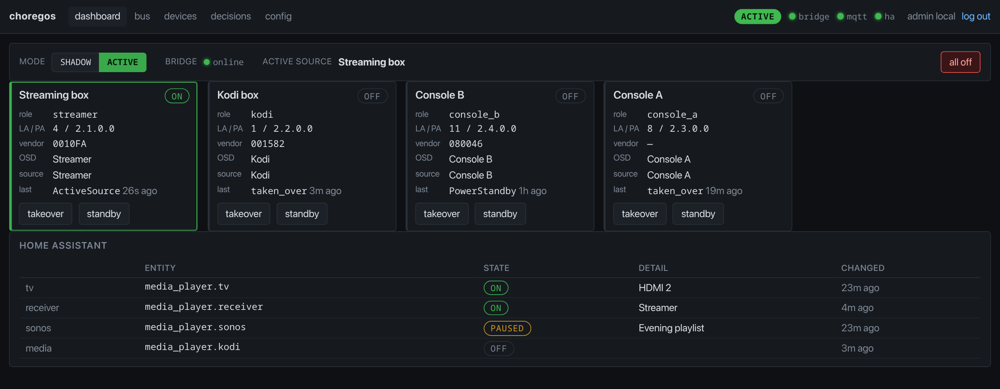
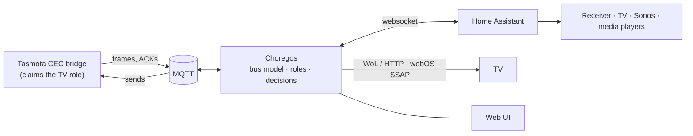
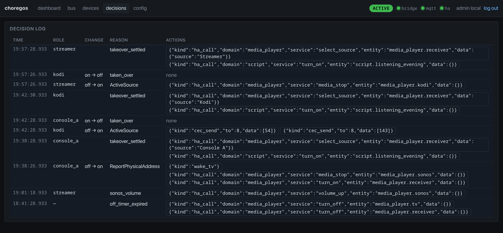

# Choregos

**A home-theater conductor.** Choregos listens to the HDMI-CEC bus through a
Tasmota CEC bridge and keeps the room in step: wake the TV and receiver when a
source wakes, pick the right input, put displaced sources to sleep, shut the
room down when the last one goes quiet. Use each source's own remote; Choregos
handles the rest.

[](https://github.com/yasen-pavlov/choregos/actions/workflows/ci.yml)
[](https://github.com/yasen-pavlov/choregos/releases)
[](https://sonarcloud.io/summary/new_code?id=yasen-pavlov_choregos)
[](https://sonarcloud.io/summary/new_code?id=yasen-pavlov_choregos)
[](LICENSE)



## Why

CEC alone almost works: devices announce themselves, the receiver follows the
active source, standby propagates. In a real room it falls apart at the edges.
A console that leaves the bus when it sleeps, a streamer that ignores Standby
while playing, a receiver that needs a nudge to switch inputs, a Sonos that
should follow the volume keys. Choregos owns those edges with an explicit,
testable model instead of a pile of automations.

## What it does

- **Learns the bus.** Devices are identified by OSD name, vendor ID and/or
  physical address, never by logical address alone, so sources that re-register
  on a different address are still recognised. Learned identities survive
  restarts and are re-verified on the bus before they are trusted.
- **Sequences the room.** A source waking triggers TV wake (Wake-on-LAN or
  HTTP), receiver power and input, a time-of-day Home Assistant preset, and a
  takeover of whatever was playing before. When the last source goes off, a
  cancellable delay powers down the TV and receiver.
- **Handles the awkward devices.** Presence polling for sources that vanish in
  standby; `Play: Still` before Standby for sources that ignore Standby while
  playing; verified standby with bounded retries; identity conflicts inhibit
  power actions rather than guess.
- **Forwards volume.** Remote volume keys reach Sonos while it is playing.
- **Integrates with Home Assistant.** MQTT discovery publishes per-role power
  sensors, active source, conflicts, bridge availability, a mode select and an
  all-off button; receiver, Sonos and media players use HA's integrations.
  TV power-off can use native webOS SSAP to avoid HA reconnect delays after wake.
- **Shows its work.** A web UI with dashboard, live bus stream, devices,
  decision log, config editor and manual actions, behind OIDC or a break-glass
  login.
- **Shadow mode.** Run the complete engine without touching anything and read
  what it *would* have done before switching it on.

## How it works



Every received frame updates a bus model and resolves configured roles. The
engine is a pure state machine: no network I/O, no clock reads. Injected time
drives startup warming, takeover settling, identification retries and
presence/off timers, which makes every behaviour replayable from a capture and
testable without hardware. MQTT, the HA websocket and TV power are thin adapters
that execute the engine's actions.

[DESIGN.md](DESIGN.md) is the behavioural contract; [docs/decisions.md](docs/decisions.md)
records the implementation choices made along the way.

## Requirements

- A Tasmota device with HDMI-CEC support wired to a spare HDMI input, claiming
  the TV logical address. Stock Tasmota works; the
  [patched firmware](https://github.com/yasen-pavlov/Tasmota/tree/ht/cec-v16)
  additionally reports whether each sent frame was ACKed, which lets a failed
  standby be classified as "target left the bus" instead of merely unconfirmed.
- An MQTT broker the bridge publishes to.
- Home Assistant with `media_player` entities for the receiver and TV, plus a
  long-lived access token. Sonos is optional; a source needs an entity only if
  it is stopped through HA (`ha_media_stop`).
- Optional: an OIDC provider for the web UI.

## Quick start

Images are published to `ghcr.io/yasen-pavlov/choregos` for amd64 and arm64 on
every `v*` tag; `:edge` follows `main`. Pin a release tag for production.

```sh
mkdir -p config
cp choregos.example.toml config/choregos.toml
# Edit config/choregos.toml, then export the secrets listed below.
# The container runs as uid 65532 and needs to write config saves and state.
sudo chown -R 65532:65532 config
docker run --rm --name choregos -p 8095:8095 \
  --cap-drop ALL --security-opt no-new-privileges --read-only \
  -v "$PWD/config:/config" \
  -e CHOREGOS_MQTT_PASSWORD -e CHOREGOS_HA_TOKEN \
  -e CHOREGOS_SESSION_SECRET -e CHOREGOS_OIDC_CLIENT_SECRET \
  -e CHOREGOS_LOCAL_PASSWORD \
  ghcr.io/yasen-pavlov/choregos:latest
```

Mount the **directory**, not the single file: saves replace the file by atomic
rename, which does not update a single-file bind mount. A compose equivalent is in
[`deploy/docker-compose.yml`](deploy/docker-compose.yml). The static musl image
has no shell; its health check runs `choregos healthz --url http://127.0.0.1:8095/healthz`,
and `/healthz` is unauthenticated and reports MQTT/HA connections, bridge
availability and mode. The check only verifies that the web process answers;
a healthy process is never restarted because an external system is offline.
Put the UI behind HTTPS.

Wake-on-LAN from a bridge network works when `tv.wake.broadcast` is a directed
broadcast (e.g. `192.168.1.255`) that your router forwards to the TV's network.
Otherwise use `network_mode: host`, or the `http` wake variant with a LAN wake
service.

Native webOS off uses only TLS (`wss`, port 3001 by default) and an existing
pairing key from `tv.off.key_env`; it does not initiate pairing. LG's self-signed
certificate is accepted only for this connection, so use a trusted LAN.
Each connect/register/power-state-check/turnOff/close exchange has a five-second
timeout, with up to three attempts one second apart and no fallback to HA.
Already-off, suspended or Active Standby TVs are left untouched; sending
`turnOff` can wake a standby TV. Older webOS versions without the power-state
service still receive `turnOff`. Pairing-required errors are never retried.
For containers, also pass the configured key environment variable (for example
`-e CHOREGOS_TV_KEY`). Omit `tv.off` or select `kind = "ha"` for HA power-off.

Start in `shadow` mode (the default in the example), watch the **Decisions**
page through a few evenings, then switch to `active` from the UI or over MQTT.

## Configuration

Start from [`choregos.example.toml`](choregos.example.toml) and replace its
hosts, entities, receiver sources and match rules with your own. Secrets are
accepted **only through environment variables**, never as TOML keys:

| Variable | Purpose |
| --- | --- |
| `CHOREGOS_MQTT_PASSWORD` | Broker password for `mqtt.username` |
| `CHOREGOS_HA_TOKEN` | Home Assistant long-lived access token |
| `CHOREGOS_SESSION_SECRET` | ≥ 32 bytes of random session-signing material |
| `CHOREGOS_OIDC_CLIENT_SECRET` | OIDC client secret for the web UI |
| `CHOREGOS_LOCAL_PASSWORD` | Break-glass login password; hashed by the web layer |
| *(named by `tv.wake.token_env`)* | Complete header value for HTTP wake |
| `CHOREGOS_TV_KEY` *(or `tv.off.key_env`)* | Existing LG webOS pairing key when `tv.off.kind = "webos"` |

| Section | Settings |
| --- | --- |
| root | `mode`: `shadow` or `active`. Switchable at runtime; persisted back to the file. |
| `mqtt` | `host`, `port`, `username`, `client_id` |
| `bridge` | Tasmota `topic` and the `logical_address` the bridge claims (0–14) |
| `home_assistant` | HTTP(S) base `url`; the websocket is `/api/websocket` |
| `tv` | HA `entity`; `wake` is `{kind="wol", mac, broadcast, port}` or `{kind="http", url, header, token_env}` (POST, header value from the environment); `off` defaults to `{kind="ha"}` or uses `{kind="webos", host, port=3001, key_env}` |
| `receiver` | HA `entity`, `select_source` boolean |
| `presets` | IANA `timezone` and `[[presets.slot]]` entries (`from`, `to` as `HH:MM`, HA `script`). Slots must cover exactly 24 hours; `24:00` is valid only as an end. |
| `sonos` | HA `entity`, `mute_switch`, `volume_from` role IDs whose volume keys are forwarded while Sonos is `playing` |
| `timing` | `off_delay_s`, `takeover_settle_ms`, `standby_retries` (default 2, 0–10), `presence_poll_s`, `presence_misses`, `identify_retry_s`. Intervals and misses must be positive. |
| `fake_tv` | `replies` (default `true`; `false` when the bridge firmware answers directed TV requests itself), `power_status`, `cec_version`, `osd_name` (1–14 ASCII bytes). Never answers Request Active Source. |
| `[[device]]` | One per role: unique `role`, `name`, `kind` (`playback`/`recording`), `match`, unique receiver `source`, `on`/`off` event lists, `takeover`, `presence`, optional HA `media_player` |
| `web` | `bind`, externally visible `public_url`; `web.oidc` (`issuer`, `client_id`); `web.local_login` (`username`) |

`web`, `mqtt`, `home_assistant`, `tv.wake` and `tv.off` changes require a restart and are
rejected by the in-app editor, so an authenticated user cannot redirect
credentials elsewhere. Everything else is editable live: the editor shows the
file verbatim with comments, validates, then replaces it atomically and reloads.

### Roles

Each `[[device]]` is a role. Every key in its `match` table must match the
learned identity: `osd` (trimmed exact name), `vendor` (six hex digits),
`physical` (dotted, e.g. `2.1.0.0`). One role matching several logical addresses,
or several roles matching one address, is a conflict: Choregos shows it and
withholds power actions for the roles involved. Role IDs match `[a-z0-9_]+` and
may not be `bridge`, `mode`, `conflicts`, `active_source` or `all_off`.

| Setting | Values |
| --- | --- |
| `on` / `off` events | `image_view_on`, `text_view_on`, `active_source`, `power_on`, `standby`, `inactive_source`, `power_standby`, `report_physical_address` |
| `takeover` | `cec_standby` (Standby `36`, then power query `8F`), `cec_pause_standby` (`Play: Still` `41 25`, `36`, `8F`: for sources that ignore Standby while playing), `ha_media_stop` (needs `media_player`), `none` |
| `presence` | `events`, or `poll` for playback devices that leave the bus in standby |

In active mode every CEC stop is verified: only an observed Standby or
Transition power report from that address counts. The sequence is sent once,
then re-sent after each `takeover_settle_ms` up to `standby_retries` more times
(`0` disables retries). Exhaustion records `standby_unconfirmed`, or, with
patched firmware, `standby_target_absent` when every frame was NACKed and none
ACKed (normal for devices that leave the bus in standby).
Replies to the verification query update bus state but can never wake a role
back up; a real On event from the user still cancels verification.

### Persisted state

`choregos.state.json` lives beside the config (`/config/choregos.state.json` in
Docker) and holds learned identities (logical/physical address, vendor, OSD name,
device type, last confirmation time) and the newest 2000 decisions. No frames,
credentials, live power or active-source state are stored. Restored identities
stay unverified until the bus confirms their physical address (or re-confirms
both cached vendor and OSD name); confirmations older than 30 days are dropped
on load. Writes are coalesced, atomic and off the event loop; a missing,
corrupt or unknown-version file logs a warning and starts empty. Delete it
while stopped to forget everything and re-interrogate the bus.

### MQTT exposure

| Topic | Direction | Purpose |
| --- | --- | --- |
| `tele/<bridge.topic>/SENSOR`, `tele/<bridge.topic>/LWT`, `stat/<bridge.topic>/RESULT` | in | CEC frames, bridge availability, send results |
| `cmnd/<bridge.topic>/HdmiSend` | out | CEC frames to send |
| `homeassistant/…/config` (retained) | out | HA discovery: role power sensors, active source, conflicts, mode select, all-off button, bridge sensor |
| `choregos/status` | out | `online`/`offline` (last will) |
| `choregos/state/<name>` (retained) | out | Entity states |
| `choregos/cmd/mode`, `choregos/cmd/all_off` | in | `shadow`/`active`; any payload triggers all-off |

One instance per broker namespace.

## Shadow mode

In `shadow` the complete engine runs and publishes its learned states and
decisions, but the executor allows only read-only traffic on the bus:
identification, startup/resync interrogation and presence polls. TV wake/off, HA
service calls, raw CEC, fake-TV replies and volume forwarding are logged as
`would:` with their payload instead of being sent. Mode and config persistence
and HA discovery keep working, so the dashboard and HA entities are fully live
while you check the decisions against what actually happened.

## Web UI

| Page | Shows |
| --- | --- |
| `/` | Mode switch, bridge/MQTT/HA status, TV/receiver/Sonos, each role's power with takeover/standby buttons, active source, all-off |
| `/bus` | Live frame stream (SSE) with decoded opcodes and operands |
| `/devices` | Bus table (addresses, identity keys, power, last seen, matched role) with manual identify; roles; raw frame send |
| `/decisions` | The decision ring with reasons and actions |
| `/config` | Validate-and-save editor for the TOML file |

Every decision records the role, the transition, the reason and the exact
actions that followed (or, in shadow mode, would have followed):



Authentication is OIDC (`web.oidc`) with a local break-glass account
(`web.local_login` + `CHOREGOS_LOCAL_PASSWORD`). Sessions are signed with
`CHOREGOS_SESSION_SECRET`; the cookie is `Secure` whenever `web.public_url` is
`https` (or unusable), so put the UI behind HTTPS.

## Development

Rust stable, edition 2024, no JavaScript build step. CI runs formatting, clippy,
tests with LLVM coverage to SonarCloud, and a Docker build; releases are cut
from signed `v*` tags with [git-cliff](cliff.toml) notes (the crate version stays
`0.0.0`; the tag is the release identity).

```sh
cargo fmt --check
cargo clippy --all-targets -- -D warnings
cargo test
cargo run -- check-config --config choregos.toml
cargo run -- replay fixtures/capture-streamer-wake.jsonl --config choregos.example.toml
```

`replay` feeds a captured MQTT log (timestamps plus bus/LWT payloads) through
the engine, advances its timers, and prints the resulting decisions and actions
as JSON. It never connects to anything and needs no secrets. Engine behaviour
tests in [`tests/replay.rs`](tests/replay.rs) use the same injected time. The
production loop is tested against an in-process `rumqttd` broker and a fake HA
websocket: shadow suppression, mode/config persistence, retained discovery and
state, broker restart and HA disconnect, with reconnects that really close
sockets. None of it needs a home theater.

## License

[MIT](LICENSE)
